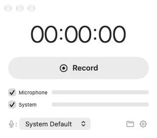

# kRecord

A minimal native macOS recorder for meetings: it records your microphone and all system audio at the same time and saves them to a file automatically. Built only on Apple system frameworks: no virtual audio drivers, no Screen Recording permission, nothing leaves your Mac.

## Requirements

- macOS 15 or later
- Apple silicon Mac (M1 or newer)

## Installation

1. Download `kRecord-<version>.zip` from [Releases](https://github.com/kozian/kRecord/releases) and unzip it.
2. Move `kRecord.app` to Applications.
3. kRecord is not notarized, so macOS blocks the first launch. Either run
   `xattr -dr com.apple.quarantine /Applications/kRecord.app`
   or try to open it once and then choose **Open Anyway** in System Settings → Privacy & Security.

## Good to know

- **Permissions.** kRecord asks for microphone access and for system audio recording (System Settings → Privacy & Security → Screen & System Audio Recording, "System Audio Recording Only"). macOS does not tell apps whether system audio is allowed: if it is blocked, recordings simply have silent system audio, and kRecord shows a hint after such a recording.
- **Where recordings go.** `~/Music/kRecord/` by default; another folder can be chosen in Settings. Files are named by start time, e.g. `kRecord 2026-10-10 14-30-05.m4a`, and never overwrite existing files.
- **Formats.** Audio is AAC, 48 kHz. While recording it is written as an `.aac` stream, so a crash or power loss keeps everything recorded so far; on stop it is repackaged to `.m4a` without re-encoding (turn off "Save as m4a" to keep `.aac`). "Save microphone and system audio as separate files" writes a mono `(mic)` file and a stereo `(system)` file of equal length, aligned to each other.
- **Devices.** By default the microphone follows the macOS default input, and kRecord follows device changes during a recording with a short gap. Output devices (speakers, headphones) can be changed freely.
- **Echo cancellation** (Settings) removes speaker sound picked up by the microphone, for meetings without headphones. It changes the sound of the voice, and macOS lowers other audio by a few decibels while it is on, so the system audio track is quieter too.
- Closing the window does not stop a recording; quitting while recording asks first and saves the file.
- Interface languages: English and Russian, following the system language.

## Development

Building, testing, and releasing are described in [DEVELOPMENT.md](DEVELOPMENT.md).

## License

[MIT](LICENSE) © 2026 Konstantin Kuznetsov
